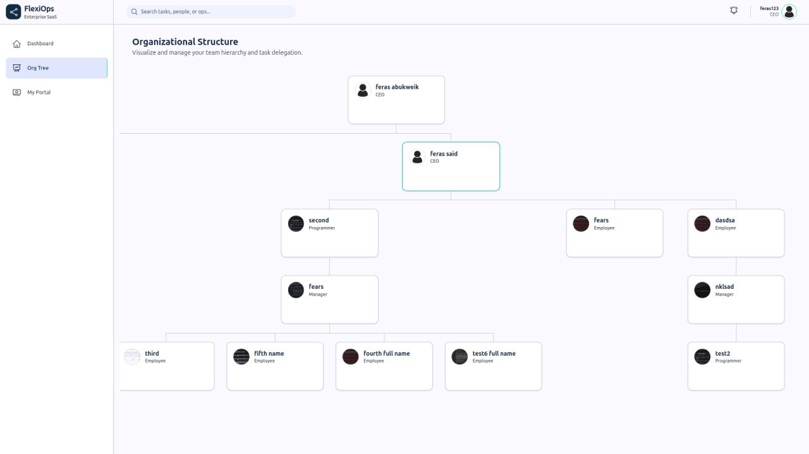
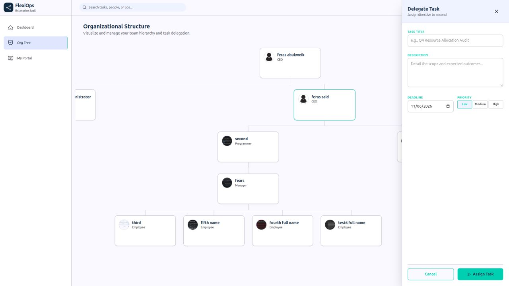
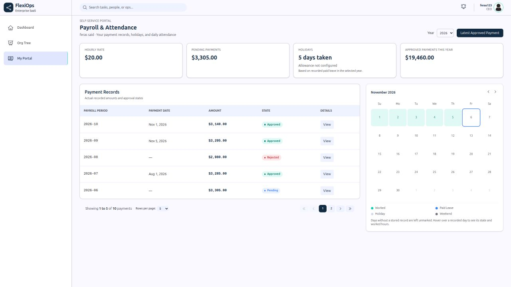
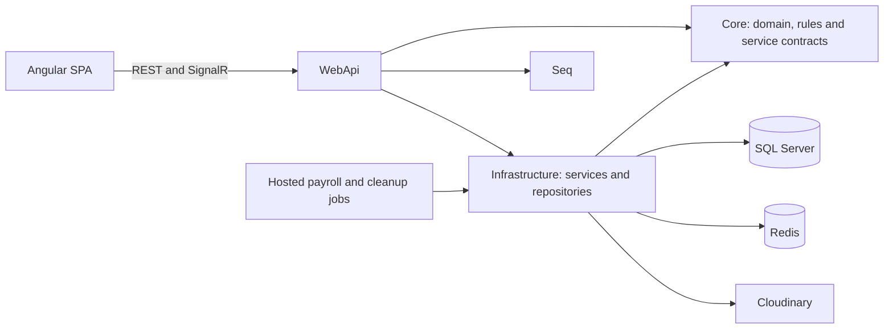

# Company System

Manage reporting lines, task approvals, attendance and monthly payroll in one workspace.

[](https://dotnet.microsoft.com/) [](https://angular.dev/) [](compose.yaml)

## Screenshots







## Key features

**Employees and managers**

- Explore reporting lines by expanding one branch at a time.
- Delegate tasks within a reporting branch and send completion or leave requests to a direct manager.
- Chat with colleagues and receive notifications as work progresses.

**Administration**

- Manage employee accounts and reporting relationships.
- Record attendance and review daily work history.
- Generate monthly pay from recorded hours and hourly rates, then review payment status.
- Give employees access to their own work records and payslips.

## Architecture



Core holds the hierarchy and workflow contracts. Infrastructure implements
them with Identity, EF Core and Redis. The Web API wires those pieces together
and translates expected failures from the Result pattern into HTTP responses.
Decorators attach logging and cache behavior at service boundaries.

## Design decisions

### Reporting hierarchy

- **Problem** · Managers need both immediate reports and full branch membership.
- **Solution** · The client loads branches on demand; SQL Server stored procedures resolve descendants and ancestors. Redis caches hierarchy reads behind a service decorator.
- **Trade-off** · Hierarchy changes must invalidate cached reads, and recursive queries are tied to SQL Server.

### Real-time updates

- **Problem** · Chat and work events should reach the affected employees while they are using the app.
- **Solution** · The authenticated app hub handles chat and typing, and the notification pipeline sends updates to their recipients.
- **Trade-off** · Clients need persisted history and unread state when they reconnect.

### Authentication and token rotation

- **Problem** · Employee sessions must renew while honoring role and account changes.
- **Solution** · Identity and JWT bearer authentication use HttpOnly, Secure, SameSite=Strict cookies. Refresh tokens rotate and the API checks account activity.
- **Trade-off** · Local development needs trusted HTTPS and compatible frontend and API origins.

### Attendance and pay integrity

- **Problem** · A retry or concurrent review can otherwise duplicate or overwrite payroll records.
- **Solution** · Unique indexes enforce one work record per employee/day and one payment per employee/month. Checks constrain payment values, and the payment state is an EF concurrency token.
- **Trade-off** · The job and review flows must handle duplicate generation and conflicting state changes.

## Tech stack

| Area | Technology |
| --- | --- |
| Backend | ASP.NET Core .NET 10, EF Core 10, Result pattern |
| Frontend | Angular 22, signals, Tailwind CSS 4 |
| Data and caching | SQL Server 2022, Redis 7, Cloudinary |
| Real-time | SignalR app hub |
| Security | ASP.NET Core Identity, JWT cookies, role checks and lockout |
| Testing | xUnit, Moq, FluentAssertions, EF InMemory and SQLite, Vitest |
| DevOps | Docker Compose, Nginx, Serilog and Seq |

## Getting started

Use Docker with Compose, the .NET 10 SDK and EF Core CLI 10.x for the first
database migration. Run each stack separately if it uses the same host ports.

```bash
git clone https://github.com/FerasAbukweik/Company_System.git
cd Company_System
```

Create a local `.env` in the repository root. Supply these values before
starting Compose.

| Variable | Local value |
| --- | --- |
| `ASPNETCORE_ENVIRONMENT` | `Development` for Scalar |
| `DB_NAME` | A database name you choose |
| `SA_PASSWORD` | A strong SQL Server password |
| `JWT_KEY` | A generated signing key |
| `SeqPassword` | A new Seq admin password |
| `CloudName`, `ApiKey`, `ApiSecret` | Your Cloudinary settings |

Compose mounts the API PFX from `https/aspnetapp.pfx` and Nginx PEM files from
`FrontEnd/Company_System/ssl/`. Use trusted local development certificates.
If you replace the PFX, supply its password through a local Compose override.
The checked-in Compose file sets the current PFX password inline.

Before running the EF command, set the host environment variable
`ConnectionStrings__Default` to your local SQL Server connection
(`localhost,1433`, user `sa`, and the database name and password from `.env`).
Compose reads `.env` for containers. The host EF CLI reads its own environment.
Install `dotnet-ef` 10.x if it is missing.

```bash
docker compose up -d --wait company-system-sqlserver company-system-redis
dotnet ef database update --project src/Company_System.Infrastructure --startup-project src/Company_System.WebApi
docker compose up -d --build
```

| Service | Address |
| --- | --- |
| Angular | [https://localhost:4000](https://localhost:4000) |
| API | [https://localhost:8081](https://localhost:8081) |
| Scalar | [https://localhost:8081/scalar/v1](https://localhost:8081/scalar/v1), Development |
| Seq | [http://localhost:5341](http://localhost:5341) |
| SQL Server / Redis | `localhost:1433` / `localhost:6379` |

For host development, run SQL Server and Redis locally and set the API's
connection, signing and media settings using environment variables or user
secrets. Trust your local development HTTPS certificate and preserve API port
`8081`, which is built into the frontend URL configuration.

```bash
dotnet run --project src/Company_System.WebApi --no-launch-profile -- --urls https://localhost:8081
```

In a second terminal with Node.js 22.22.3+ on the 22.x line or 24.15.0+ on 24.x:

```bash
cd FrontEnd/Company_System
npm ci
npm start
```

Open [http://localhost:4200](http://localhost:4200). The Compose app uses HTTPS
on both origins for its secure session cookies.


Migrations create roles. The repository does not provide a ready-to-use seeded
login or an automated first-admin flow. An initial administrator must be
provisioned before using the employee management UI.

## Running tests

```bash
dotnet test Company_System.slnx
cd FrontEnd/Company_System
npm ci
npm test -- --watch=false
```

The backend suites cover service rules and EF repository behavior, including
transactional notifications. Frontend coverage includes auth, hierarchy loading,
SignalR clients, attendance, payroll and employee views. See the
[test notes](tests/README.md) for backend test organization.

## Project structure

```text
src/
├── Company_System.Core/             # Domain types and contracts
├── Company_System.Infrastructure/   # Persistence, decorators, and hosted jobs
└── Company_System.WebApi/           # Controllers, cookies, and SignalR
FrontEnd/Company_System/             # Angular app and Nginx config
tests/                               # Service and repository suites
compose.yaml                         # Local service topology
```

## API overview

Use [Scalar](https://localhost:8081/scalar/v1) in Development to explore the
API. Controller groups cover authentication and users, hierarchy, tasks,
approvals and activities, work records and payments, messages and notifications.
SignalR is served at `/hubs/app`.

## Author

Firas Abukweik · [LinkedIn](https://www.linkedin.com/in/firas-abukweik/) ·
[GitHub](https://github.com/FerasAbukweik) · [Email](mailto:firas.abukweik@gmail.com)
